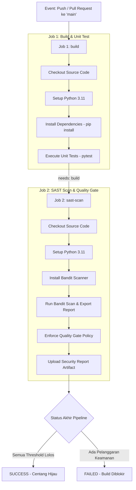

# DevSecOps Pipeline P5: Secure Task Management API


Proyek ini dibangun untuk memenuhi penugasan praktikum **DevSecOps Praktik 5** dengan fokus pada integrasi berkesinambungan (*Continuous Integration*), analisis keamanan statis (*Static Application Security Testing* / SAST), dan penegakan gerbang kendali mutu (*Quality Gate*) menggunakan **GitHub Actions**.

- **Nama Mahasiswa**: Dhio Patty Alexander
- **NIM**: 0110225006
- **Repository**: [devsecops-p5-0110225006](https://github.com/dhiopattyalexander/devsecops-p5-0110225006)

---

## 1. Nama Aplikasi & Fungsinya

### Nama Aplikasi:
**Secure Task & Audit Management REST API**

### Fungsi Aplikasi:
Aplikasi ini merupakan layanan backend RESTful API yang berfungsi untuk mengelola siklus penugasan tugas (*task management*) dan kredensial pengguna secara aman dengan prinsip *secure coding*. Fitur utamanya mencakup:
1. **User Authentication & Credential Management**: Pendaftaran dan otentikasi pengguna menggunakan enkripsi hashing PBKDF2-HMAC-SHA256 dengan *cryptographic salt* untuk menangkal serangan *dictionary* dan *rainbow table*.
2. **Task Lifecycle Management**: Operasi CRUD (Create, Read, Update status, Delete) untuk penugasan kerja tim dengan prioritas dinamis (*Low*, *Medium*, *High*, *Critical*).
3. **Input Sanitization & Injection Defense**: Sanitasi otomatis pada setiap string input pengguna guna memitigasi risiko Cross-Site Scripting (XSS) dan injeksi karakter berbahaya.
4. **Directory Traversal Protection**: Validasi nama file dan parameter input untuk mencegah serangan *Path Traversal* (CWE-22).
5. **System Health & Observability**: Endpoint pemantauan kesehatan layanan (`/health`) dan structured audit logging.

---

## 2. Bahasa & Framework yang Digunakan

Aplikasi dan pipeline ini dibangun dengan teknologi sebagai berikut:

- **Bahasa Pemrograman**: [Python](https://www.python.org/) (versi 3.10 / 3.11 / 3.12 / 3.14)
- **Web Framework**: [Flask 3.0+](https://flask.palletsprojects.com/) & [Werkzeug](https://palletsprojects.com/p/werkzeug/) (Microframework modular dan terukur)
- **Unit Testing Framework**: [pytest](https://docs.pytest.org/) untuk pengujian otomatis logika bisnis, keamanan, dan rute REST
- **SAST Tool (Static Application Security Testing)**: [Bandit](https://github.com/PyCQA/bandit) untuk memindai kerentanan kode Python berdasarkan basis data kelemahan umum (CWE / OWASP Top 10)
- **CI/CD Platform**: [GitHub Actions](https://github.com/features/actions) berbasis runner `ubuntu-latest`

### Struktur File Source Code (Minimal 5 File Bermakna)
Repository ini memiliki arsitektur modular yang terdiri dari 5 modul inti yang saling terintegrasi:

```text
src/
├── app.py          # 1. Controller & HTTP REST API routing (Health, Auth, Tasks)
├── models.py       # 2. Data Entity & validasi skema (User, Task, Priority, Status)
├── services.py     # 3. Logika bisnis (CRUD TaskService & UserService)
├── security.py     # 4. Modul keamanan (PBKDF2-SHA256, XSS sanitization, Token generation)
└── utils.py        # 5. Helper utilitas (Structured Logging, Standard JSON response)
```

Selain itu, terdapat file pengujian dan penegakan Quality Gate:
- `tests/test_services.py`: Pengujian unit pada logika layanan tugas dan pengguna.
- `tests/test_security.py`: Pengujian unit pada sanitasi input, validasi keamanan, dan hashing.
- `tests/test_app.py`: Pengujian end-to-end endpoint API Flask menggunakan fixture client.
- `scripts/quality_gate.py`: Skrip evaluasi laporan SAST yang menerapkan ambang batas lolos/gagal.

---

## 3. Cara Menjalankan Aplikasi

### A. Persyaratan Awal (Prerequisites)
Pastikan Python 3.10 atau versi yang lebih baru sudah terpasang di sistem operasi Anda.

### B. Langkah Instalasi & Menjalankan Lokal

1. **Clone Repository**:
   ```bash
   git clone https://github.com/dhiopattyalexander/devsecops-p5-0110225006.git
   cd devsecops-p5-0110225006
   ```

2. **Buat dan Aktifkan Virtual Environment** (Opsional tapi disarankan):
   ```bash
   # Di Windows (PowerShell):
   python -m venv venv
   .\venv\Scripts\Activate.ps1

   # Di Linux / macOS:
   python3 -m venv venv
   source venv/bin/activate
   ```

3. **Install Dependencies**:
   ```bash
   pip install -r requirements.txt
   ```

4. **Menjalankan Unit Test**:
   ```bash
   pytest -v tests/
   ```

5. **Menjalankan SAST Scanner (Bandit) secara Lokal**:
   ```bash
   bandit -r src/ -f txt
   ```

6. **Menjalankan Server Aplikasi**:
   ```bash
   python -m src.app
   ```
   Aplikasi akan berjalan pada `http://127.0.0.1:5000`.

### C. Daftar Endpoint API Utama

| Method | Endpoint | Deskripsi |
|---|---|---|
| `GET` | `/health` | Memeriksa status kesehatan layanan backend |
| `POST` | `/api/v1/auth/register` | Mendaftarkan akun pengguna baru |
| `POST` | `/api/v1/auth/login` | Otentikasi dan login pengguna |
| `GET` | `/api/v1/tasks` | Mengambil seluruh daftar tugas (bisa difilter via `?status=pending`) |
| `POST` | `/api/v1/tasks` | Membuat tugas baru |
| `GET` | `/api/v1/tasks/<task_id>` | Mengambil detail tugas berdasarkan ID |
| `PUT` | `/api/v1/tasks/<task_id>/status` | Memperbarui status pengerjaan tugas |
| `DELETE` | `/api/v1/tasks/<task_id>` | Menghapus tugas berdasarkan ID |

---

## 4. Overview Pipeline CI/CD & DevSecOps yang Diimplementasikan

Pipeline DevSecOps diatur di dalam file [`.github/workflows/devsecops.yml`](.github/workflows/devsecops.yml) dan dieksekusi secara otomatis oleh GitHub Actions.

### A. Mekanisme Pemicu (Trigger Events)
Pipeline akan otomatis berjalan ketika:
- Terdapat event **`push`** ke branch **`main`**.
- Terdapat event **`pull_request`** yang diajukan ke branch **`main`**.

### B. Arsitektur Dua Job Terpisah (Two-Stage Pipeline)



### C. Rincian Konfigurasi Job:

1. **Job 1: `build`** (Runner: `ubuntu-latest`)
   - Melakukan checkout repositori.
   - Mengonfigurasi lingkungan runtime Python 3.11 dengan caching dependencies.
   - Menginstal modul pada `requirements.txt`.
   - Menjalankan unit tests dengan `pytest -v tests/` untuk menjamin integritas fungsional kode sebelum memasuki tahap analisis keamanan.

2. **Job 2: `sast-scan`** (Runner: `ubuntu-latest`, Ketergantungan: `needs: build`)
   - **Dependency Enforcement**: Menggunakan direktif `needs: build`. Job ini tidak akan pernah dieksekusi apabila Job `build` gagal.
   - **Pemindaian Keamanan Statis (SAST)**: Menjalankan engine **Bandit** pada seluruh file di dalam direktori `src/` dan menghasilkan output dalam format JSON serta TXT.
   - **Penerapan Quality Gate (`scripts/quality_gate.py`)**:
     - *High Severity Tolerance*: **0** (Ditolak / Fail jika ada temuan risiko tinggi).
     - *Medium Severity Tolerance*: **0** (Ditolak / Fail jika ada temuan risiko menengah).
     - *Low Severity Tolerance*: **Maksimal 5** (Diberikan peringatan / warning).
     - Jika evaluasi Quality Gate gagal, step akan menghasilkan *exit code 1*, membatalkan pipeline, dan menandai build sebagai gagal.
   - **Upload Artifact**: Laporan hasil pemindaian keamanan diunggah sebagai artifak build (`sast-bandit-security-report`) yang dapat diunduh langsung dari GitHub Actions.
