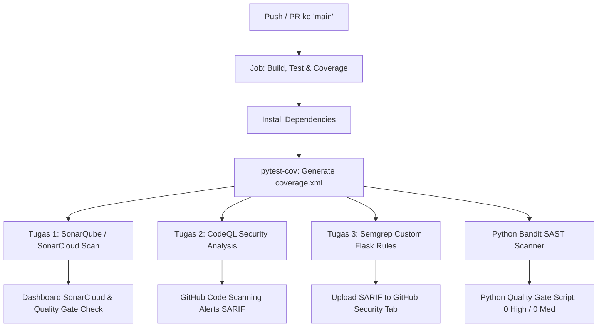

# DevSecOps Pipeline P5: Multi-Tool SAST Integration


Proyek ini dibangun untuk memenuhi penugasan praktikum **DevSecOps Praktik 5: Integrasi SAST dalam CI/CD Pipeline dengan GitHub Actions** (S1 Teknik Informatika STT Terpadu Nurul Fikri).

- **Nama Mahasiswa**: Dhio Patty Alexander
- **NIM**: 0110225006
- **Repository**: [devsecops-p5-0110225006](https://github.com/dhiopattyalexander/devsecops-p5-0110225006)

---

## 1. Pemenuhan Tugas Mandiri (Slide PPT Halaman 25)

| Butir Tugas | Target | Status & Bukti Implementasi |
|---|---|---|
| **Tugas 1 (Wajib)** | Integrasikan **SonarQube / SonarCloud** ke project via GitHub Actions. Tampilkan dashboard & Quality Gate. | Terintegrasi via `sonar-project.properties`, job `sonarqube-scan` pada GitHub Actions (`SonarSource/sonarqube-scan-action`). |
| **Tugas 2 (Wajib)** | Tambahkan **CodeQL** ke repository yang sama & buat analisis perbandingan temuan CodeQL vs SonarQube (1 paragraf). | Terintegrasi via `.github/workflows/codeql.yml` dengan engine native GitHub Security Analysis untuk Python. |
| **Tugas 3 (Bonus)** | Buat **Custom Semgrep Rule** spesifik framework yang digunakan (Flask) dan integrasikan ke pipeline. | Dibuat di `.semgrep/custom-rules.yml` mendeteksi debug mode (`CWE-489`), hardcoded secret key (`CWE-798`), dan path traversal (`CWE-22`). |
| **Laporan** | Dokumen analisis format PDF/Word memuat link repo, screenshot pipeline, screenshot dashboard, dan analisis temuan. | Disusun pada dokumen `Laporan_DevSecOps_P5_0110225006.docx`. |

---

## 2. Arsitektur Multi-Tool SAST Pipeline



---

## 3. Struktur Repository & 5 File Source Code Utama

```text
devsecops-p5-0110225006/
├── .github/
│   └── workflows/
│       ├── devsecops.yml        # Pipeline multi-job (Build, SonarQube, Semgrep, Bandit)
│       └── codeql.yml           # Pipeline native GitHub CodeQL SAST
├── .semgrep/
│   └── custom-rules.yml         # Custom ruleset Semgrep khusus Framework Flask
├── src/
│   ├── __init__.py
│   ├── app.py                   # 1. Controller & HTTP REST Routing Flask
│   ├── models.py                # 2. Skema Data Entity (User, Task, Status, Priority)
│   ├── services.py              # 3. Logika Bisnis (CRUD TaskService, UserService)
│   ├── security.py              # 4. Modul Keamanan (PBKDF2-SHA256, XSS, Path Traversal)
│   └── utils.py                 # 5. Structured Audit Logging & Response Formatter
├── tests/
│   ├── __init__.py
│   ├── test_app.py              # Unit test endpoint REST
│   ├── test_security.py         # Unit test fungsi kriptografi & sanitasi
│   └── test_services.py         # Unit test alur bisnis & manajemen pengguna
├── scripts/
│   └── quality_gate.py          # Script evaluator Quality Gate
├── sonar-project.properties     # Konfigurasi SonarQube / SonarCloud Scanner
├── requirements.txt             # Dependensi Python
└── README.md
```

---

## 4. Cara Menjalankan Secara Lokal

1. **Clone Repository**:
   ```bash
   git clone https://github.com/dhiopattyalexander/devsecops-p5-0110225006.git
   cd devsecops-p5-0110225006
   ```

2. **Install Dependensi**:
   ```bash
   pip install -r requirements.txt
   ```

3. **Jalankan Unit Test & Coverage**:
   ```bash
   pytest -v --cov=src --cov-report=xml:coverage.xml tests/
   ```

4. **Jalankan Semgrep dengan Custom Rules Flask**:
   ```bash
   semgrep scan --config=.semgrep/custom-rules.yml
   ```

5. **Jalankan Aplikasi Server**:
   ```bash
   python -m src.app
   ```

---

## 5. Panduan Menghubungkan ke SonarCloud (Tugas 1)

1. Buka [https://sonarcloud.io](https://sonarcloud.io) lalu klik **Log in with GitHub**.
2. Klik tombol **"+"** di kanan atas -> pilih **Analyze new project**.
3. Pilih repository `devsecops-p5-0110225006`.
4. Buka **My Account** (ikon profil) -> **Security** -> Generate Token dengan nama `github-actions`.
5. Buka repository GitHub: **Settings** -> **Secrets and variables** -> **Actions** -> **New repository secret**:
   - Name: `SONAR_TOKEN`
   - Secret: *[Paste token dari SonarCloud]*
6. Jalankan ulang workflow pada tab **Actions** di GitHub. Pipeline akan langsung terhubung ke dashboard SonarCloud!
